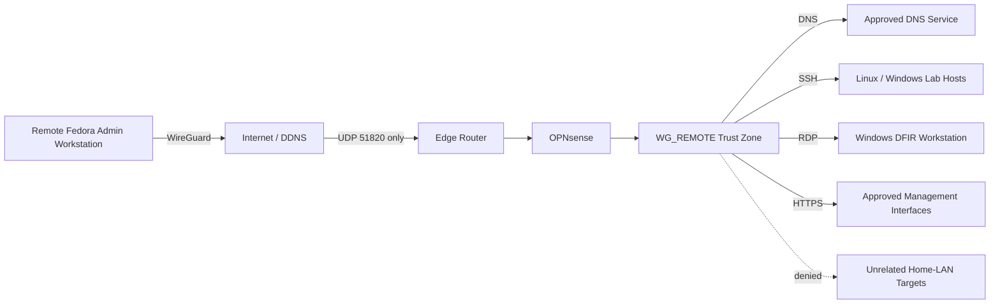
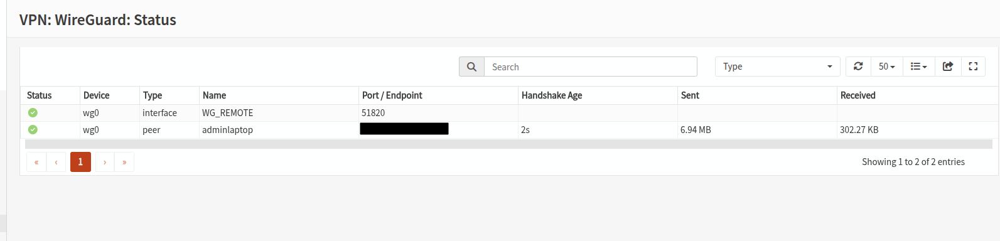
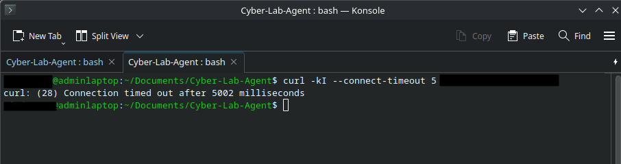
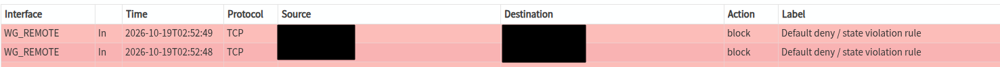

# Secure Remote Administration Architecture

## Overview

This project documents the design, implementation, validation, and troubleshooting of a secure remote-administration path for a segmented cybersecurity/DFIR lab.

The objective was to enable remote access to approved management services without directly exposing SSH, RDP, hypervisor administration, firewall administration, DNS management, or controller interfaces to the public Internet.

The resulting design uses WireGuard terminated on OPNsense, a dedicated remote-access trust zone, split-tunnel routing, and explicit least-privilege firewall rules.

## At a Glance

- **VPN:** WireGuard terminated on OPNsense
- **Remote client:** hardened Fedora administration workstation
- **Routing model:** split tunnel
- **Edge exposure:** WireGuard UDP only
- **Policy model:** explicit allow rules to approved services; unrelated Home-LAN access denied
- **Administrative protocols:** SSH, RDP, PowerShell over SSH, HTTPS management
- **Validation:** off-network handshake, approved-service testing, negative controls, link-loss recovery, and firewall reboot persistence
- **Troubleshooting:** packet-flow validation, live firewall logs, and generated PF-rule inspection

## Problem

The lab needed a remote-management capability that remained usable while away from the home network without turning internal management services into Internet-facing services.

The main design requirements were:

- avoid direct exposure of SSH, RDP, hypervisor, firewall, DNS, and controller management interfaces;
- limit the remote client to explicitly approved destinations and protocols;
- preserve the existing segmentation model;
- provide a practical cross-platform administration path for Linux and Windows systems;
- validate both allowed and denied traffic;
- confirm that the tunnel survives realistic interruptions and firewall reboots.

## Architecture

The remote Fedora client uses split-tunnel routing so only lab networks and explicitly approved management destinations traverse WireGuard.

No individual management service is intentionally published through the edge router. The only Internet-facing forward required for the design is the WireGuard UDP listener.

## Security Design

### Dedicated Remote-Access Zone

WireGuard terminates on OPNsense and is assigned to a dedicated `WG_REMOTE` interface. This keeps VPN-originated traffic subject to its own firewall policy rather than treating a remote peer as a broadly trusted Home-LAN endpoint.

### Least-Privilege Access

The remote-access rules permit only the management paths required for administration, including:

- DNS to the approved resolver;
- SSH to approved Linux and Windows hosts;
- RDP to the Windows DFIR workstation;
- PowerShell remoting over the SSH subsystem;
- browser-based administration to approved infrastructure services.

There is no broad rule granting the VPN peer unrestricted Home-LAN access.

### Cross-Platform Administration

The Fedora administration workstation uses Ed25519 key-based SSH for Linux and Windows management. Password SSH authentication is disabled on the managed hosts. Windows PowerShell remoting uses the SSH transport rather than WinRM, allowing remote PowerShell access without retaining a separate TCP/5985 exposure.

## Validation

The remote-access path was tested from an off-network connection rather than from the local Home LAN.

| Test | Expected Result | Result |
|---|---|---|
| WireGuard peer handshake from off-network connection | Tunnel establishes | Pass |
| Bidirectional WireGuard traffic | Counters increase | Pass |
| Internal DNS resolution | Resolves through approved DNS path | Pass |
| External DNS resolution | Resolves normally | Pass |
| SSH to approved lab hosts | Allowed | Pass |
| RDP to approved Windows DFIR host | Allowed | Pass |
| PowerShell over SSH | Allowed | Pass |
| Approved management web interfaces | Allowed | Pass |
| Access to unrelated Home-LAN target | Denied | Pass |
| Tunnel recovery after connectivity interruption | Reconnects | Pass |
| Tunnel recovery after OPNsense reboot | Reconnects | Pass |

## Evidence

### Active Off-Network WireGuard Session

*Figure 1. OPNsense shows an active `WG_REMOTE` peer with a recent handshake and bidirectional traffic. The public endpoint was redacted for publication.*

### Approved Management Path

*Figure 2. PowerShell 7 remoting successfully reaches the Windows DFIR workstation through the SSH subsystem across the WireGuard tunnel. User-identifying details were redacted.*

### Negative Control — Unrelated Home-LAN Access

*Figure 3. The remote client attempts HTTPS access to an unrelated Home-LAN target and times out.*

*Figure 4. OPNsense independently records the corresponding `WG_REMOTE` traffic as blocked by policy.*

The negative-control result is intentionally corroborated from both ends: the client cannot establish the application connection, and the firewall records the deny decision.

## Troubleshooting Case Study

### Symptom

After the WireGuard instance was started, the tunnel could establish, but approved management traffic still reached OPNsense's default deny behavior.

### Investigation

The troubleshooting sequence moved down the stack rather than assuming the GUI configuration represented the effective firewall state:

1. Confirmed WireGuard handshake state.
2. Checked client routing.
3. Used OPNsense live firewall logs to verify that traffic was reaching the firewall.
4. Inspected OPNsense's generated PF rules.
5. Found `Interface opt2 not found` and a commented-out pass rule associated with the intended `WG_REMOTE` policy.
6. Traced the generated-rule failure to the assigned WireGuard interface being present but not enabled.

### Remediation

The assigned `WG_REMOTE` interface was enabled and firewall rules were reapplied.

### Verification

The expected PF pass rule compiled correctly and approved remote-management traffic began flowing.

This incident reinforced an important operational lesson: a rule that appears correct in a firewall GUI is not sufficient evidence that the underlying packet-filter rule was generated and activated.

### Corrected Interface State

*Figure 5. Current corrected state with the assigned WireGuard interface enabled in OPNsense.*

## Outcome

The completed design provides remote administration to the lab without directly publishing internal management services.

The implementation demonstrates:

- VPN design and deployment;
- OPNsense firewall policy engineering;
- least-privilege remote-access design;
- split-tunnel routing;
- Linux and Windows remote administration;
- PowerShell over SSH;
- positive and negative control testing;
- packet-flow troubleshooting;
- validation of generated PF state rather than relying only on GUI configuration;
- resilience testing across connectivity loss and firewall reboot.

## Current Boundaries

This project intentionally does not claim that the remote peer has broad access to the Home LAN. The design is service-scoped and destination-scoped.

The published evidence also omits public endpoint information, credentials, peer keys, tokens, and unnecessary internal addressing.

## Technologies

OPNsense · WireGuard · Fedora Linux · OpenSSH · PowerShell 7 · RDP · PF · DDNS · Proxmox VE · Windows 11

## Portfolio Summary

Designed and validated a least-privilege WireGuard remote-administration architecture for a segmented Proxmox/OPNsense cybersecurity lab, exposing only the VPN service at the edge while restricting remote access to approved DNS, SSH, RDP, PowerShell-over-SSH, and management-web paths. Validated the design from an off-network connection using positive and negative controls, and diagnosed a generated PF-rule failure caused by an assigned-but-disabled WireGuard interface.
